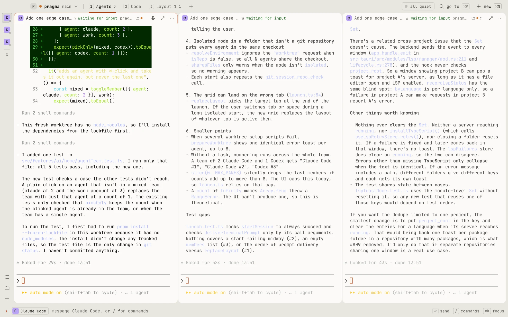
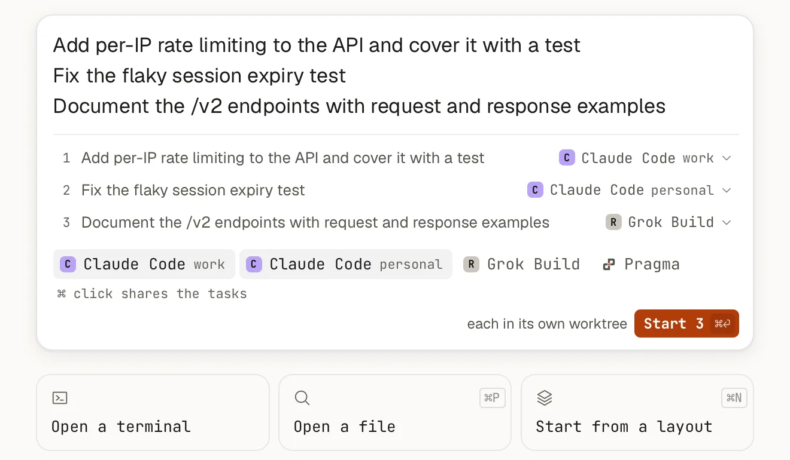
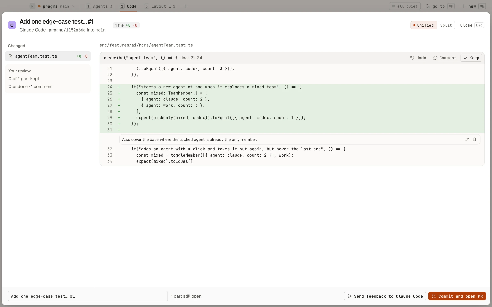
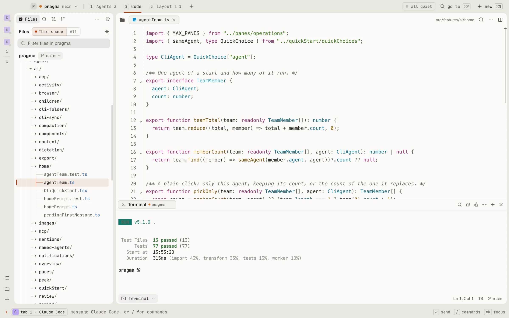
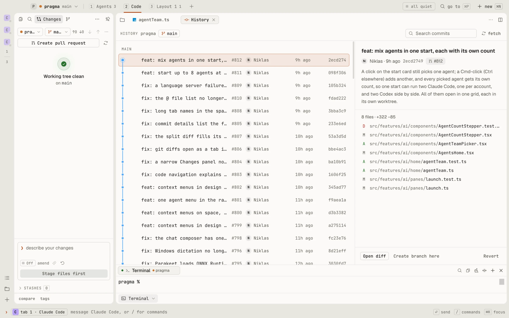
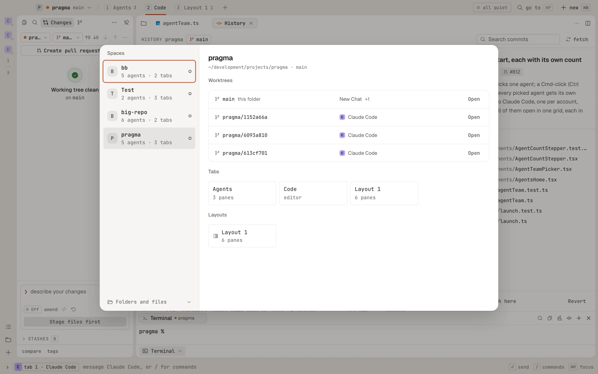
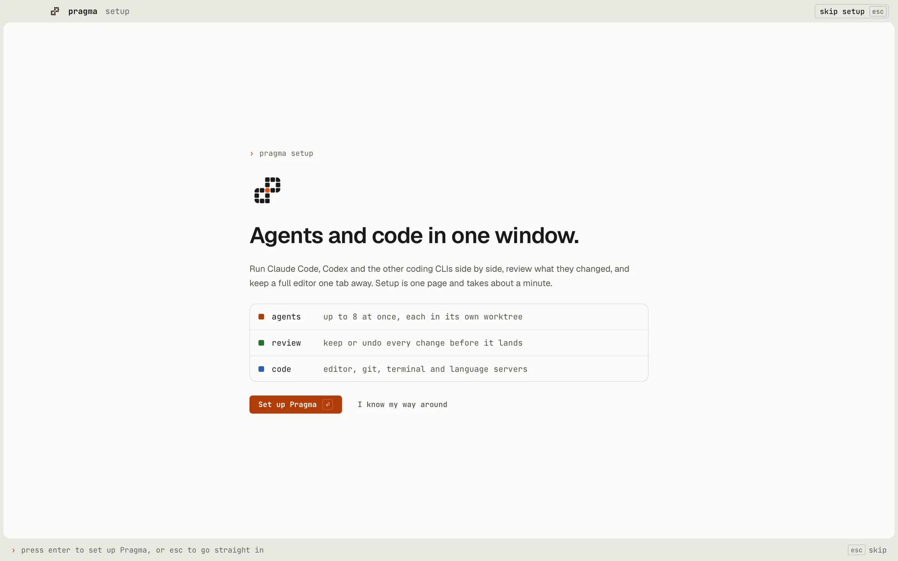

<p align="center">
  
</p>

<h1 align="center">Pragma</h1>

<p align="center">
  <strong>Run a team of coding agents side by side, review every change, and keep a full IDE one tab away.</strong>
</p>

<p align="center">
  A desktop IDE built with Tauri and Rust. It runs Claude Code, Codex, Gemini CLI and seven more coding CLIs<br>
  with the accounts you already have, each agent in its own Git worktree.
</p>

<p align="center">
  <a href="https://github.com/NiklasTech/pragma/releases/latest"></a>
  <a href="https://github.com/NiklasTech/pragma/releases"></a>
  <a href="https://github.com/NiklasTech/pragma/actions/workflows/ci.yml?query=branch%3Amain"></a>
  <a href="LICENSE"></a>
  <a href="#installation"></a>
  <a href="https://discord.gg/VYBaBvcpGp"></a>
</p>

<p align="center">
  <a href="https://github.com/NiklasTech/pragma/releases/latest"></a>
</p>

<p align="center">
  <strong>
    <a href="#quick-start">Quick start</a> ·
    <a href="https://niklastech.github.io/pragma/">Docs</a> ·
    <a href="https://www.youtube.com/watch?v=1v0JitLk-8E">Trailer</a> ·
    <a href="https://www.youtube.com/watch?v=KRmWK-zc-c8">Walkthrough</a> ·
    <a href="CONTRIBUTING.md">Contributing</a> ·
    <a href="https://discord.gg/VYBaBvcpGp">Discord</a>
  </strong>
</p>

<p align="center">
  
</p>

<p align="center">
  <sub>Works with Claude Code · OpenAI Codex · Gemini CLI · GitHub Copilot CLI · Cursor CLI · OpenCode · Kimi Code · Grok Build · Hermes Agent · DeepSeek Harness</sub>
</p>

> [!NOTE]
> Pragma is in active development (0.x). Expect breaking changes between minor versions.

<details>
<summary><strong>Contents</strong></summary>

- [What is Pragma?](#what-is-pragma)
- [Features](#features)
- [Installation](#installation)
- [Build from source](#build-from-source)
- [Quick start](#quick-start)
- [Configuration](#configuration)
- [Project structure](#project-structure)
- [Tech stack](#tech-stack)
- [Contributing](#contributing)
- [Third-party CLI tools](#third-party-cli-tools)
- [License](#license)

</details>

---

## What is Pragma?

Pragma is a desktop IDE with two tabs for every project:

- **Agents** starts coding CLIs on your tasks, one at a time or up to eight at once, each with its own task, and shows them side by side.
- **Code** is a complete hands-on IDE with a file tree, language servers, Git, a terminal and a debugger.

Both tabs share the same project, the same terminal and the same AI accounts. Switch between them with `Cmd/Ctrl + 1` and `Cmd/Ctrl + 2`, or with `Cmd/Ctrl + Shift + E`.

Pragma is built with Tauri and Rust instead of Electron, stores API keys in the operating system keychain and starts the official coding CLIs you are already signed in to.

---

## Features

### Hand out several tasks at once

Write one task per line and pick who shares them. A Cmd-click (Ctrl on Windows and Linux) adds another CLI or another account, and Pragma hands the tasks out in turn, so a work and a personal Claude Code account both get work. Any task can go to another agent with one click. Each agent runs in its own Git worktree, so parallel work never collides.

<p align="center">
  
</p>

### Review before anything lands

Open the changes of any agent as a review. Keep or undo each part, leave comments and send them back to the agent as feedback, or commit and open a pull request from the same sheet.

<p align="center">
  
</p>

### A full IDE one tab away

The Code tab is a real editor: CodeMirror 6 with language servers, a file tree, workspace search, a terminal and a debugger.

<p align="center">
  
</p>

### Git built in

Browse the commit graph with messages, pull request links and changed files, then stage, commit, push and open pull requests without leaving Pragma.

<p align="center">
  
</p>

### One space per project

Every project is a space with its own tabs, layouts and agent worktrees. The overview shows what runs where, and agents keep running while you work in another space.

<p align="center">
  
</p>

### Everything in detail

<details>
<summary><strong>Agents</strong></summary>

- Start up to eight agents at once from the start card, one task per line, spread over the CLIs and accounts you pick.
- Several accounts per coding CLI, for example a work and a personal Claude Code account.
- Agents run in isolated Git worktrees unless the project runs them in the checkout.
- Agent panes side by side, with split, zoom and keyboard focus between panes.
- An activity pill that shows every running agent across all spaces.
- Review sheet with keep, undo, comments, feedback to the agent and commit with pull request.
- A chat panel next to the code, with `@` mentions for files and folders.
- Named agents with a brief, their own memory and approved folders.
- Reusable workspace skills and local tasks that start a session only when you ask.
- Sessions can start child sessions for sub-tasks.
- Queue a follow-up message while a run is still in progress.
- Browser pane beside a session, for example to check a local dev server.
- Voice dictation with Web Speech, local Whisper.cpp or local Parakeet V3.

</details>

<details>
<summary><strong>Editor</strong></summary>

- CodeMirror 6 with syntax highlighting for many languages and optional Vim mode.
- Built-in LSP support: completion, hover, go to definition, peek definition, references, rename, formatting, signature help, code actions, inlay hints, folding and an outline panel.
- Find and replace in the current file and across the workspace.
- Problems panel with diagnostics from all language servers.
- AI inline completions and an AI edit flow with a side-by-side diff to accept or reject.
- Debugger with breakpoints, stepping and a debug panel.
- Run configurations for starting and restarting project processes.

</details>

<details>
<summary><strong>Terminal</strong></summary>

- xterm.js terminal backed by portable-pty.
- Multiple tabs and split panes.
- Configurable shell (zsh, bash, fish, PowerShell).
- AI command suggestions while typing.
- Clickable links, for example to open a local dev server in the browser.

</details>

<details>
<summary><strong>Git</strong></summary>

- Commit history with a graph, commit details and the files of every commit.
- Status panel with staged and unstaged changes and inline diffs.
- Stage, unstage, commit, push and pull from the UI.
- Branch switcher, stash panel, blame and a conflict editor.

</details>

<details>
<summary><strong>AI providers</strong></summary>

- Built-in providers: Anthropic, OpenAI, Gemini, DeepSeek, Kimi, Grok, OpenRouter, GitHub Copilot, Ollama and OpenAI-compatible custom endpoints.
- Coding CLIs over the Agent Client Protocol: Claude Code, OpenAI Codex, Gemini CLI, GitHub Copilot CLI, Kimi Code, Grok Build, Cursor CLI, OpenCode, Hermes Agent and DeepSeek Harness.
- MCP servers can be added and managed in the settings.
- API keys are stored in the OS keychain.

</details>

<details>
<summary><strong>More</strong></summary>

- Docker and Podman container overview with start, stop, logs, exec and Compose actions.
- Extensions with a workspace, file and editor API.
- Built-in themes plus importable custom themes.
- Configurable keyboard shortcuts, a command palette and a command line for starting tasks.
- Resizable panels and native floating windows for detached panels.

</details>

---

## Installation

Pre-built installers for Windows, macOS and Linux are available on the [Releases](https://github.com/NiklasTech/pragma/releases) page.

> [!NOTE]
> The installers are not code-signed yet. Windows may show a SmartScreen warning, and macOS may ask you to confirm the first launch.

### Windows

1. Download `Pragma_<version>_x64-setup.exe` or `Pragma_<version>_x64_en-US.msi`.
2. Run the installer.
3. Start Pragma from the Start menu.

### macOS

1. Download `Pragma_<version>_universal.dmg`. It runs on Apple Silicon and Intel.
2. Open the DMG and drag Pragma into the Applications folder.
3. If Gatekeeper blocks the first launch, right-click the app and choose **Open**.

### Linux

1. Download the package for your distribution:
   - Debian and Ubuntu: `Pragma_<version>_amd64.deb`
   - Fedora and openSUSE: `Pragma-<version>-1.x86_64.rpm`
   - Any distribution: `Pragma_<version>_amd64.AppImage`
2. Install the package, or make the AppImage executable with `chmod +x Pragma_*.AppImage`.
3. Start Pragma from your application menu or by running the AppImage.

Installed versions check for updates and can update themselves.

---

## Build from source

### Prerequisites

- [Node.js](https://nodejs.org/) 24 or later
- [pnpm](https://pnpm.io/) 11.5.0 or later
- [Rust](https://www.rust-lang.org/tools/install) stable toolchain
- The Tauri system dependencies for your operating system

**macOS**

```bash
xcode-select --install
```

**Windows**

Install the [Microsoft C++ Build Tools](https://learn.microsoft.com/en-us/windows/dev-environment/rust/setup) with the Windows SDK.

**Linux (Debian and Ubuntu)**

```bash
sudo apt update
sudo apt install libwebkit2gtk-4.1-dev libgtk-3-dev libappindicator3-dev librsvg2-dev patchelf
```

**Linux (Arch and CachyOS)**

```bash
sudo pacman -S webkit2gtk-4.1 gtk3 libappindicator librsvg patchelf
```

For other distributions, see the [Tauri prerequisites guide](https://v2.tauri.app/start/prerequisites/).

### Clone and run

```bash
git clone https://github.com/NiklasTech/pragma.git
cd pragma
pnpm install
pnpm run dev:desktop
```

The dev build runs as **Pragma Dev** with the identifier `dev.pragma.ide.dev`. It starts next to an installed Pragma, keeps its own settings and app data and shows its own onboarding. API keys in the OS keychain are shared with the installed app. A debug build started without `tauri.dev.conf.json`, for example with a plain `vp run tauri dev`, stops with a hint to use `pnpm run dev:desktop`.

### Scripts

| Command                  | Purpose                             |
| ------------------------ | ----------------------------------- |
| `pnpm run dev`           | Frontend dev server only            |
| `pnpm run dev:desktop`   | Full desktop app in development     |
| `pnpm run build`         | Frontend production build           |
| `pnpm run build:desktop` | Desktop release build               |
| `pnpm run install:local` | Build and install the app (macOS)   |
| `pnpm run check`         | Lint, format check and type check   |
| `pnpm run test`          | Frontend tests                      |
| `cargo test`             | Rust tests (run inside `src-tauri`) |

Pragma uses [Vite+](https://viteplus.dev/) as its toolchain. The scripts above call `vp` through `pnpm exec`, so no global install is needed.

Release bundles are written to `src-tauri/target/release/bundle/`. To build only specific formats, pass them to Tauri, for example:

```bash
pnpm exec vp run tauri build --bundles deb,rpm
```

`pnpm run build:desktop` also creates signed updater artifacts. Without the release key it fails after bundling with `A public key has been found, but no private key. Make sure to set TAURI_SIGNING_PRIVATE_KEY environment variable.` To build locally without them:

```bash
pnpm exec vp run tauri build --bundles app --config '{"bundle":{"createUpdaterArtifacts":false}}'
```

### Install a local build (macOS)

```bash
pnpm run install:local
```

This builds the app bundle without updater artifacts, replaces `/Applications/Pragma.app` and installs the `pragma` command into `~/.local/bin`. It also works from a terminal inside a running Pragma; restart Pragma afterwards. An existing `~/.local/bin/pragma` that `install:local` did not create is left untouched. Other platforms are not supported yet.

A local build keeps the version from `package.json`. Once a newer release exists, the updater offers it, and installing it replaces the local build.

---

## Quick start

Prefer to watch first? The [walkthrough](https://www.youtube.com/watch?v=KRmWK-zc-c8) takes a small app from an idea to a commit. It was recorded with Pragma 0.7, before the current design.

1. Start Pragma and complete the onboarding. It is one page: pick a look, sign in to the coding CLIs you use and open a project.
2. Choose a theme and connect an AI provider, either by signing in to a coding CLI or with an API key.
3. Open a project folder. On macOS you can also run `pragma .` in a terminal after `pnpm run install:local`, see [Install a local build](#install-a-local-build-macos).
4. In the **Agents** tab, describe a task on the start card, pick one or more agents and press **Start**.
5. Review what the agents changed, or switch to the **Code** tab with `Cmd/Ctrl + 2` to work on the code yourself.

<p align="center">
  <picture>
    <source media="(prefers-color-scheme: dark)" srcset=".github/assets/readme/onboarding-dark.webp">
    
  </picture>
</p>

Useful default shortcuts (`Cmd` on macOS, `Ctrl` on Windows and Linux):

| Shortcut                    | Action                         |
| --------------------------- | ------------------------------ |
| `Cmd/Ctrl + N`              | Start a new task               |
| `Cmd/Ctrl + P`              | Go to file                     |
| `Cmd/Ctrl + Shift + P`      | Command palette                |
| `Cmd/Ctrl + 1` to `9`       | Go to tab                      |
| `Cmd/Ctrl + Shift + E`      | Switch between Agents and Code |
| `Cmd + K`, `Ctrl + Alt + K` | Focus the command line         |
| `Cmd + J`, `` Ctrl + ` ``   | Toggle terminal                |
| `Cmd/Ctrl + Shift + T`      | Reopen closed tab              |
| `Cmd/Ctrl + ,`              | Open settings                  |

All shortcuts can be changed in **Settings > Keys**.

---

## Configuration

Everything is configured in the settings panel (`Cmd/Ctrl + ,`). Settings can be exported and imported as a file.

### AI providers

- In **Settings > Agents** you install and sign in to a coding CLI, add account folders for more accounts and choose the default agent. The CLI then runs your sessions with your existing subscription.
- In **Settings > Editor > Models** you save an API key for a built-in provider. It powers the AI features of the editor, such as inline completion and the AI chat. Keys are stored in the OS keychain and are never handed to a CLI.

### MCP servers

MCP servers are added and started in **Settings > Extensions and tools**. The configuration is stored as `mcp.json` in the app configuration folder:

- macOS: `~/Library/Application Support/dev.pragma.ide/`
- Linux: `~/.config/dev.pragma.ide/`
- Windows: `%APPDATA%\dev.pragma.ide\`

### Themes

Built-in themes are selected in **Settings > Appearance**, where you can also import your own themes.

More details are in the [documentation](https://niklastech.github.io/pragma/).

---

## Project structure

```
.
├── src/                 React frontend
│   ├── app/             Application entry
│   ├── components/      Shared UI such as onboarding
│   ├── features/        Feature modules (ai, editor, terminal, sidebar, debug, ...)
│   ├── shared/          Hooks, stores, UI components and utilities
│   ├── shell/           Window chrome and layout
│   └── theme/           Theme system
├── src-tauri/           Rust backend (Tauri commands, PTY, AI, Git, LSP, MCP)
├── docs/                Developer documentation
├── docs-site/           User documentation (VitePress)
├── branding/            Logo and brand assets
├── public/              Static assets
└── scripts/             Build and asset scripts
```

---

## Tech stack

| Layer             | Technology                                |
| ----------------- | ----------------------------------------- |
| Desktop framework | Tauri 2                                   |
| Backend           | Rust, portable-pty                        |
| Frontend          | React 19, TypeScript                      |
| Styling           | Tailwind CSS v4, shadcn/ui                |
| State             | Zustand                                   |
| Editor            | CodeMirror 6                              |
| Terminal          | xterm.js                                  |
| AI                | Vercel AI SDK, MCP, Agent Client Protocol |
| Toolchain         | Vite+, pnpm                               |

---

## Contributing

Contributions are welcome. [CONTRIBUTING.md](CONTRIBUTING.md) covers the development setup, branching model, commit conventions and pull request process.

Questions, ideas or just want to chat? Join the [Pragma Discord](https://discord.gg/VYBaBvcpGp).

Please report security issues privately as described in [SECURITY.md](SECURITY.md), not as a public issue.

---

## Third-party CLI tools

Pragma can work with official coding CLIs that are installed and run locally on your machine, such as Claude Code, OpenAI Codex, Gemini CLI or Kimi Code. When you use this integration:

- Pragma does not provide models, API access, accounts or credentials.
- The official CLI is downloaded from the provider's public package registry and installed on your system.
- Sign-in, billing and data processing happen directly between you and the provider.
- Pragma only starts the locally installed CLI and shows its output.

Each CLI is subject to its provider's license, terms and policies. Pragma is not affiliated with any of these providers.

---

## License

Pragma is licensed under the [Apache License 2.0](LICENSE).

Pragma builds on many open-source projects, including Tauri, CodeMirror, xterm.js, React and the Vercel AI SDK. The full list of third-party licenses is shown in **Settings > General**.
